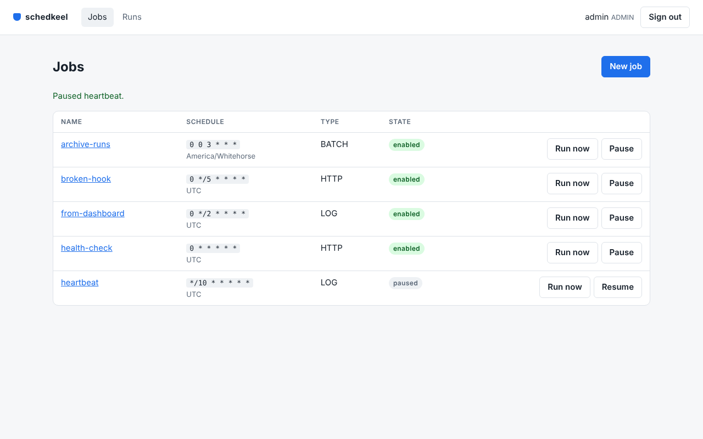
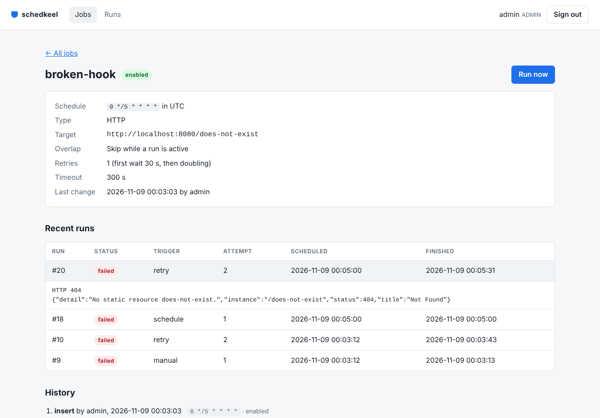

# schedkeel

A distributed job scheduler on Spring Boot 4. You define jobs with a cron expression and a time zone. schedkeel queues a run when each job is due, then executes it on 1 of any number of server instances. It retries failures with back-off and keeps every run, plus every change to a job. An Angular dashboard and a terminal client sit on top of the same REST API.



## What it does

- Runs 6 kinds of job: HTTP calls, Kafka messages, RabbitMQ messages, Apache Pulsar messages, Spring Batch jobs, log lines (for smoke tests). A RabbitMQ job waits for the broker's confirm and fails when its message reaches no queue. A Pulsar job waits until the broker has stored its message.
- Reads 6-field cron expressions (seconds first) in any time zone, so `0 30 2 * * *` in `America/Toronto` fires at 2:30 local time all year. A fire time that a daylight-saving change removes is skipped.
- Queues 1 run after an outage, not 1 run per missed slot.
- Retries a failed run up to 10 times. The wait doubles after each failure, from a base you choose, up to 1 hour.
- Stops a run that takes longer than its timeout and marks it `TIMED_OUT`.
- Recovers runs from an instance that stopped mid-run: a run still `RUNNING` a minute past its timeout fails, then gets its next attempt when the job has retries left.
- Lets a job forbid overlap: while a run is still queued or running, the next fire is recorded as `SKIPPED`.
- Scales out: every instance claims runs from 1 PostgreSQL queue with `FOR UPDATE SKIP LOCKED`, so no run is taken twice. A Redis lease picks 1 instance to turn cron schedules into runs.
- Starts runs from outside the schedule: a button, an API call, the CLI, a message on a Kafka topic, a message on a RabbitMQ queue.
- Announces every finished run on a Kafka topic as JSON. The event goes through Spring Modulith's publication log in the database, which sends again any event left unsent at a restart.
- Keeps every version of every job (who changed what, when) with Hibernate Envers.
- Archives old runs to CSV files and deletes them from the database with a Spring Batch job, which you schedule like any other job.
- Exposes run durations by job and outcome, plus the queue length, to Prometheus.

## Who it is for

Teams that run cron jobs on several servers today and want 1 place to see what ran, what failed, who changed a schedule. It is also a working reference for 17 Spring projects in 1 code base, each doing a real job, with tests against real PostgreSQL, Redis, Kafka.

## Spring projects in use

| Spring project | Where | What it does here |
|---|---|---|
| Spring Boot 4.1.2 | everywhere | Auto-configuration, Actuator health probes, Testcontainers service connections |
| Spring Framework 7.0.10 | `scheduling`, `run`, `execution` | `CronExpression` for schedules, `JdbcClient` for the queue SQL, `RestClient` for HTTP jobs |
| Spring Data JPA | `job` | Job definitions, with created-by and changed-by auditing |
| Spring Data Envers | `job` | Every version of a job, with the user who made it |
| Spring Data JDBC | `run` | Run history as a simple aggregate, with paging |
| Spring Data Redis | `scheduling` | The leader lease (`SET NX` with an expiry, renewed by a Lua script) |
| Spring Security 7.1.2 | `security` | Form sign-in for the dashboard, HTTP Basic for scripts, the VIEWER role, the ADMIN role, CSRF tokens for the browser |
| Spring Session 4.1.1 | `security` | Dashboard sessions in Redis, so any instance can serve any user |
| Spring Modulith 2.1.2 | all modules | Module boundaries checked by a test, module diagrams, the event publication log |
| Spring Batch 6.0.6 | `housekeeping` | The `archiveRuns` job: a chunk step to CSV, then a delete step |
| Spring for Apache Kafka 4.1.2 | `trigger`, `notify`, `execution` | Trigger topic listener, run-events publisher, Kafka jobs |
| Spring AMQP 4.1.2 | `trigger`, `execution` | Trigger queue listener, RabbitMQ jobs with publisher confirms and returns |
| Spring for Apache Pulsar 2.0.8 | `execution` | Pulsar jobs through `PulsarTemplate`, keyed by the job name (Pulsar client 4.2.5) |
| Spring HATEOAS 3.1.3 | `job`, `run`, `web` | HAL responses with links such as `pause`, `resume`, `trigger` |
| Spring REST Docs 4.0.2 | tests | API documentation built from the integration tests |
| Spring Shell 4.0.3 | `cli` | The `schedkeel` terminal client |
| Micrometer 1.17.2 | `execution` | `schedkeel.run.duration` timer and `schedkeel.runs.queued` gauge for Prometheus |

[ROADMAP.md](ROADMAP.md) plans 26 more steps, each bringing in another Spring project, from Spring Integration to Spring Initializr.

## How it fits together

```
        dashboard (Angular)      schedkeel CLI (Spring Shell)     Kafka and RabbitMQ: schedkeel.triggers
                 \                        |                                  |
                  +------ REST API (HAL, problem details) ------+            |
                                          |                                  v
   +------------------------------- server (Spring Modulith) ----------------------------------+
   |  job: definitions + history     scheduling: cron -> queued run (leader only)               |
   |  run: queue + history           execution: claim, run, time out, retry, metrics            |
   |  security: sign-in, roles       trigger: Kafka or RabbitMQ -> queued run                   |
   |  housekeeping: archiveRuns batch job     notify: run -> Kafka     web: API root, dashboard |
   +--------------------------------------------------------------------------------------------+
          |                          |                          |                          |
     PostgreSQL                    Redis                      Kafka                    RabbitMQ          Pulsar
  jobs, history, runs,        leader lease,           triggers, run events,      triggers,         PULSAR jobs
  batch metadata, event log   sessions                KAFKA jobs                 AMQP jobs
```

Each top-level package under `server/src/main/java/io/github/jkanie/schedkeel` is a Spring Modulith module. `ModularityTests` fails the build when a module reaches into another module's internals, and writes PlantUML diagrams to `server/build/spring-modulith-docs`.

## Built with

- Java 21 (CI also runs on Java 25), Gradle 9.8.2 with the Kotlin DSL and a version catalogue.
- PostgreSQL 17, Redis 8, Apache Kafka 4.1, RabbitMQ 4.1, Apache Pulsar 4.2.5 (Docker images for local work and for tests).
- Hibernate 7.4.13 with Envers, Flyway 12.4.0 migrations.
- Angular 22.2 (stand-alone components, signals, no zone.js), TypeScript 6.0.
- Tests: JUnit 5, AssertJ, Testcontainers 2.0.5, Spring Modulith test support, Vitest 5.1 for the dashboard.
- Format checks: Spotless with palantir-java-format for Java, Prettier for the dashboard.

## Set-up

You need Java 21 or newer, Docker, Node.js 22 (for the dashboard).

Start PostgreSQL, Redis, Kafka, RabbitMQ, Pulsar:

```sh
docker compose up -d
```

Set the 2 sign-in passwords (the server refuses to start without them), then build and run the server with the dashboard inside:

```sh
export SCHEDKEEL_ADMIN_PASSWORD='choose-one'
export SCHEDKEEL_VIEWER_PASSWORD='choose-another'
./gradlew :server:bootJar -PwithDashboard
java -jar server/build/libs/server-0.1.0-SNAPSHOT.jar
```

Open http://localhost:8080 and sign in as `admin` or `viewer`.

To work on the dashboard with live reload, keep the server running and start the Angular dev server, which forwards `/api` to port 8080:

```sh
cd dashboard
npm ci
npm start
```

Then open http://localhost:4200.

### Settings

| Environment variable | Default | Meaning |
|---|---|---|
| `SCHEDKEEL_ADMIN_PASSWORD` | none (required) | Password of the `admin` user (may change jobs) |
| `SCHEDKEEL_VIEWER_PASSWORD` | none (required) | Password of the `viewer` user (may only read) |
| `SCHEDKEEL_DB_URL` | `jdbc:postgresql://localhost:5432/schedkeel` | PostgreSQL |
| `SCHEDKEEL_DB_USER`, `SCHEDKEEL_DB_PASSWORD` | `schedkeel`, `schedkeel` | Matches `compose.yaml`, for local work only |
| `SCHEDKEEL_REDIS_URL` | `redis://localhost:6379` | Redis |
| `SCHEDKEEL_KAFKA_SERVERS` | `localhost:9092` | Kafka bootstrap servers |
| `SCHEDKEEL_RABBITMQ_ADDRESSES` | `localhost:5672` | RabbitMQ host and port |
| `SCHEDKEEL_RABBITMQ_USER`, `SCHEDKEEL_RABBITMQ_PASSWORD` | `guest`, `guest` | The default user of the `rabbitmq` Docker image in `compose.yaml`, for local work only |
| `SCHEDKEEL_PULSAR_URL` | `pulsar://localhost:6650` | Pulsar broker for `PULSAR` jobs. The server starts without a broker, and only a `PULSAR` run needs one. |

Other settings live under `schedkeel.*` in `server/src/main/resources/application.yml`. For example, `schedkeel.execution.http.allowed-hosts` limits which hosts HTTP jobs may call, and `schedkeel.archive.retention-days` (default 30) sets how long finished runs stay in the database.

## Use

### Dashboard

- **Jobs**: every job with its schedule and state. Admins also get the New job, Run now, Pause, Resume buttons.
- **A job's page**: its settings, its last 20 runs (click a run for its output), its full change history.
- **Runs**: every run, newest first, with a status filter. The page refreshes every 5 seconds.



### CLI

Build it with `./gradlew :cli:bootJar`. Each call runs 1 command and exits, so it works in scripts. With no command, it prints help.

```sh
export SCHEDKEEL_URL=http://localhost:8080 SCHEDKEEL_USER=admin SCHEDKEEL_PASSWORD='choose-one'
alias schedkeel='java -jar cli/build/libs/cli-0.1.0-SNAPSHOT.jar'

schedkeel create --name health-check --cron "0 * * * * *" --type HTTP --target http://localhost:8080/actuator/health --retries 2
schedkeel create --name archive-runs --cron "0 0 3 * * *" --zone America/Whitehorse --type BATCH --target archiveRuns
schedkeel trigger health-check
schedkeel jobs
schedkeel runs --job health-check --limit 5
schedkeel history health-check
```

```
NAME          CRON         ZONE                TYPE   ENABLED  TARGET
archive-runs  0 0 3 * * *  America/Whitehorse  BATCH  true     archiveRuns
health-check  0 * * * * *  UTC                 HTTP   true     http://localhost:8080/actuator/health
```

Other commands: `job NAME`, `run ID` (1 run with its output, such as the error of a failed run), `pause NAME`, `resume NAME`, `delete NAME`.

### API

Start at `GET /api` and follow the links. `./gradlew :server:asciidoctor` writes the API guide, with every example taken from a test run, to `server/build/docs/asciidoc/index.html`. CI keeps the same file as the `api-docs` artifact of each run.

```sh
curl -u admin:choose-one -H 'Content-Type: application/json' http://localhost:8080/api/jobs -d '{
  "name": "nightly-report", "cron": "0 0 2 * * *", "timeZone": "Europe/Paris",
  "type": "HTTP", "target": "https://reports.example.org/build", "maxRetries": 2 }'
```

Errors come back as problem details (`application/problem+json`), for example `{"status": 400, "detail": "'0 2 * * *' is not a valid cron expression. Use 6 fields: ..."}`.

### Kafka, RabbitMQ, Pulsar

- Send a job name to the Kafka topic `schedkeel.triggers` to queue a run of that job.
- Or send it to the RabbitMQ queue `schedkeel.triggers` (the server declares the queue at start-up). The run's trigger is then `AMQP`.
- An `AMQP` job publishes its payload to the target `exchange/routing-key`, for example `billing/invoice.due`. An empty exchange (`/orders`) is RabbitMQ's default exchange, which routes to the queue named by the key. The run fails when the broker refuses the message (an exchange that does not exist) or returns it (no queue bound to that key), because a dropped message would otherwise look like success.
- A `PULSAR` job sends its payload to the target topic, with the job name as the message key and the properties `x-schedkeel-job` and `x-schedkeel-run`. The target takes 3 forms: a short name (`orders` means `persistent://public/default/orders`), `tenant/namespace/topic` (a persistent topic there), a full `persistent://` or `non-persistent://` name (used as it is). The run waits up to the job's timeout for the broker to store the message, and fails when the broker refuses it, as for a tenant that does not exist.
- Read `schedkeel.run-events` for every finished run, keyed by job name: `{"runId":7,"jobId":2,"jobName":"health-check","status":"SUCCEEDED","trigger":"SCHEDULE","attempt":1,...}`.

### Metrics

`GET /actuator/prometheus` (ADMIN only) includes `schedkeel_run_duration_seconds` by job and status, plus `schedkeel_runs_queued`.

## Tests

```sh
./gradlew build                  # Java: format check, compile with warnings as errors, 95 tests
cd dashboard && npm test         # dashboard: 29 tests
```

The server's integration tests start PostgreSQL 17, Redis 8, Kafka 4.1, RabbitMQ 4.1, Pulsar 4.2.5 in Docker through Testcontainers, once per test run. A test clock stands still until a test moves it, so schedule tests do not wait for real time. Among them:

- 8 workers claim 200 queued runs at the same time, and no run is claimed twice.
- 2 runs left `RUNNING` by a stopped instance fail 1 minute past their timeout, not sooner, and each gets 1 retry.
- An outage of 45 minutes on an every-minute job queues 1 run.
- A failed HTTP call is retried after its back-off. The wait doubles each time, and retries stop after the last one.
- A job's history shows each change with the user who made it.
- The dashboard's sign-in flow runs as a browser does it: XSRF-TOKEN cookie, X-XSRF-TOKEN header, SESSION cookie in Redis. A POST without the header gets 403.
- The `archiveRuns` batch job writes old runs to CSV, deletes them, leaves recent runs.
- A message on the trigger topic queues a run. Every finished run reaches the run-events topic.
- A RabbitMQ job's message reaches the bound queue with its payload and headers. A message that reaches no queue fails the run with the broker's `312 NO_ROUTE`, and an exchange that does not exist fails it too. A job name on the RabbitMQ trigger queue queues a run.
- A Pulsar job's message reaches a subscriber with its payload, the job name as key, the job and run properties. A short topic name lands in `public/default`, and a tenant that does not exist fails the run.

## Project layout

```
server/      Spring Boot application (1 Spring Modulith module per package)
cli/         Spring Shell terminal client
dashboard/   Angular dashboard (built into the server jar with -PwithDashboard)
compose.yaml PostgreSQL, Redis, Kafka, RabbitMQ, Pulsar for local work
```

## Licence

MIT. See [LICENSE](LICENSE).
